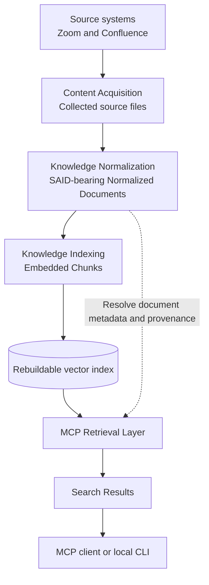
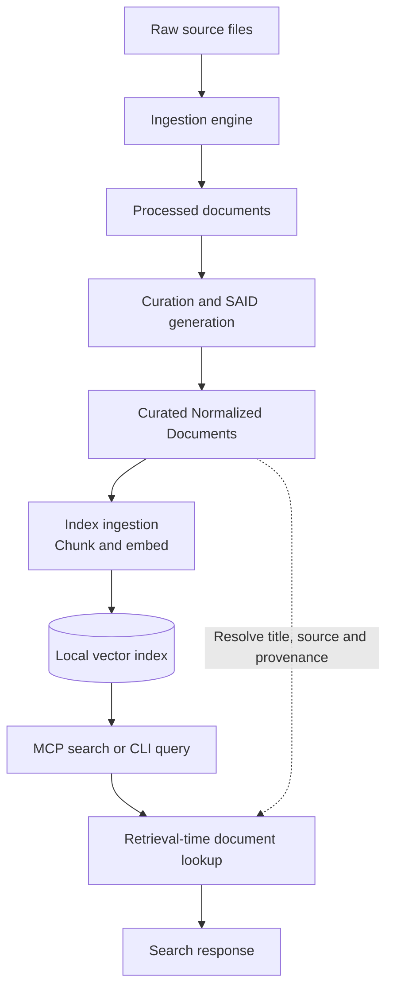

# MCP Knowledge Retrieval Platform

A prototype for retrieving organizational knowledge through the Model Context Protocol (MCP), with explicit links from search results to the documents from which they were derived. It acquires source material, normalizes documents, generates searchable chunks and embeddings, and exposes retrieval through a local MCP server.

**Current focus:** Zoom meeting material and Confluence pages, verifiable Normalized Document identity, traceable retrieval, and reproducible evaluation. The project is under active development. A working retrieval path is not, by itself, proof of source authenticity, completeness, retrieval quality, or production readiness.

## What is available today

| Area | Implemented in the current `main` | Important qualification |
| --- | --- | --- |
| Source handling | Zoom transcripts, captions, chat and AI summaries; Confluence export parsing | GitHub and YouTube are architectural targets, not completed ingestion integrations. |
| Normalization | Source-specific parsing, curation, provenance fields and self-addressed Normalized Documents (SAIDs) | The authoritative Raw Artifact and provenance contracts are still being refined in [#8](https://github.com/trustoverip/egwg-reporting-tf-prototype-mcp/issues/8). |
| Indexing | Local chunking, `fastembed` embeddings, vector index, incremental ingestion and explicit pruning/rebuild options | The index is derived and rebuildable. Updates and pruning must be coordinated with source and curation changes. |
| Retrieval | Local MCP `search` and `list_documents` tools; CLI query path | Search combines semantic and keyword ranking. The server joins indexed chunks to curated documents at retrieval time. |
| Tests | Python document-identity and normalization tests; TypeScript handoff tests; CI document-identity workflow | Component checks are not an end-to-end acceptance result or an independent real-corpus relevance assessment. |

**Scope:** The implementation supports current-state retrieval. It does not provide historical as-of or bitemporal queries. Temporal identity, observation history and retention limitations are being assessed in [PR #29](https://github.com/trustoverip/egwg-reporting-tf-prototype-mcp/pull/29), which is proposed work rather than a merged capability.

## How it fits together

The [repository architecture and workstream boundaries](AGENTS.md) govern the data models and their ownership. In particular, retrieval does not make the index authoritative for provenance.



**Architecture boundary:** Content Acquisition owns source evidence; the Raw Artifact data model remains under discussion in [#8](https://github.com/trustoverip/egwg-reporting-tf-prototype-mcp/issues/8). The vector index is a derived retrieval structure, not the authority for document metadata or provenance. The dashed path represents the retrieval-time document lookup, not a second source of truth.

The primary components are:

| Path | Responsibility | Start here |
| --- | --- | --- |
| [`mcp_data_generation/`](mcp_data_generation/) | Source parsing, ingestion registry, curation, SAID generation and identity tests | [Data generation guide](mcp_data_generation/README.md) |
| [`toip-mcp-server/`](toip-mcp-server/) | Chunking, local embeddings/index, hybrid search, CLI and MCP tools | [MCP server guide](toip-mcp-server/README.md) |
| [`scripts/`](scripts/) | Source acquisition utilities | [Acquisition instructions](mcp_data_generation/README.md#step-1-collect-raw-data) |
| [`AGENTS.md`](AGENTS.md) | Architectural workstreams, data-model ownership and source-of-truth rules | [Architecture and contributor guidance](AGENTS.md) |

**Identity and evidence boundaries.** A Normalized Document SAID identifies an exact serialized record, including its provenance metadata; it does not identify a meeting or wiki page independently of revisions. Source-reference fields and content hashes help trace records, but do not independently establish the authenticity or authority of the source. An index hit is not a verified historical assertion.

## Try the local pipeline

The operational path below distinguishes **creating an index** from **using it to retrieve results**. The MCP server and CLI read indexed chunks and resolve document metadata from the curated directory at query time.



**Operational boundary:** This depicts the ordinary current-state path, not a formal document state machine, automatic supersession policy, or historical as-of retrieval. Source updates may require explicit curation and index pruning; see the [component guides](mcp_data_generation/README.md) for lifecycle commands.

The workflow expects source material in the layout described by the [data generation guide](mcp_data_generation/README.md). The full source corpus is **not** committed to this repository. The documented read-only source cache is [LFDT-way/mcp-cache](https://github.com/LFDT-way/mcp-cache); use only data you are authorized to access and process. An existing local raw tree can be selected with `--raw`.

Requirements: Python 3, Node.js and npm. The first embedding operation downloads a model; after installation, embeddings run locally. The documented commands below use the default `mcp_data_generation/data/raw` input and default output directories, so prepare the raw input or consult the guide for alternate paths.

From the repository root:

```bash
cd mcp_data_generation
python3 -m venv .venv
./.venv/bin/python -m pip install -r requirements.txt
./.venv/bin/python -m src.ingestion_engine
./.venv/bin/python -m src.curate

cd ../toip-mcp-server
npm ci
npm run build
npm run ingest -- --limit 20
npm run query -- "bite size trust scripts"
```

This is a **small trial**, not a complete corpus build. The indexer resumes from existing records; `--limit` bounds documents newly indexed, and a trial with `--limit` must not be combined with `--prune`. The server and the CLI must be pointed to the **same curated directory** as the indexer. To start the stdio MCP server after building and indexing:

```bash
npm start
```

For a custom curated directory, set `TOIP_DATA_DIR` for retrieval as well as selecting `--data` during ingestion. The [server guide](toip-mcp-server/README.md) documents complete ingestion, `--prune`, `--rebuild`, MCP client configuration, and search options. **Do not run destructive index rebuild or pruning commands against an existing corpus without understanding their effects.**

### MCP tools

- **`search`** returns ranked passages with matching-term information and document/source references; it supports working-group filtering and an `all_chunks` option. Ranking is evidence of retrieval similarity, not source credibility or answer correctness.
- **`list_documents`** pages through indexed documents, optionally filtering by working group or content type.

The CLI uses the same search implementation and provides a `--json` output option for inspecting retrieval results. See [search behavior and command flags](toip-mcp-server/README.md#how-search-works).

## Test and interpret the results

Run the existing tests from their component directories:

```bash
cd mcp_data_generation
./.venv/bin/python -m unittest discover --start-directory tests --top-level-directory . --verbose

cd ../toip-mcp-server
npm test
npm run build
```

The [Document identity workflow](.github/workflows/document-identity.yml) runs the Python checks in CI with generated fixtures; the TypeScript handoff tests are available via `npm test`. These checks cover declared invariants, not an independently adjudicated assessment of real-world retrieval.

[Issue #26](https://github.com/trustoverip/egwg-reporting-tf-prototype-mcp/issues/26) tracks reproducible end-to-end validation: a pinned baseline, source-diverse corpus, real MCP client calls, failure cases and an evidence-backed disposition. Independent synthetic testing has identified unresolved provenance and lifecycle defects. **A green component or synthetic test run must not be read as a production-assurance PASS.** Approved real-source relevance evaluation and independent acceptance remain separate requirements.

## Current priorities and how to contribute

The workstream issues organize implementation responsibility. They should be read with [`AGENTS.md`](AGENTS.md), rather than treating the directory layout as the architecture:

| Workstream | Open coordination |
| --- | --- |
| Cross-workstream data models and provenance | [#8](https://github.com/trustoverip/egwg-reporting-tf-prototype-mcp/issues/8) |
| Content Acquisition | [#9](https://github.com/trustoverip/egwg-reporting-tf-prototype-mcp/issues/9) |
| Knowledge Normalization | [#10](https://github.com/trustoverip/egwg-reporting-tf-prototype-mcp/issues/10) |
| Knowledge Indexing | [#11](https://github.com/trustoverip/egwg-reporting-tf-prototype-mcp/issues/11) |
| MCP Retrieval Layer | [#12](https://github.com/trustoverip/egwg-reporting-tf-prototype-mcp/issues/12) |
| Testing & Evaluation | [#26](https://github.com/trustoverip/egwg-reporting-tf-prototype-mcp/issues/26) |

Immediate work emphasizes **verifying the implemented end-to-end path and resolving demonstrated integrity gaps**, before expanding the schema or adding new source integrations. Related open proposals include [retrieval evaluation (#23)](https://github.com/trustoverip/egwg-reporting-tf-prototype-mcp/pull/23), [missing-parent retrieval behavior (#24)](https://github.com/trustoverip/egwg-reporting-tf-prototype-mcp/pull/24), [index diagnostics (#25)](https://github.com/trustoverip/egwg-reporting-tf-prototype-mcp/pull/25) and [malformed JSON ingestion (#28)](https://github.com/trustoverip/egwg-reporting-tf-prototype-mcp/pull/28). These are **PRs under review**, not functionality presumed present in `main`.

Before contributing, identify the owning workstream and affected model, reproduce the behavior on a pinned revision, and propose the smallest testable correction. Keep raw evidence, normalization, indexing and MCP response responsibilities separate. Follow repository DCO/CLA checks and do not include sensitive source material or credentials in fixtures, commits or CI artifacts.

## License

See [LICENSE](LICENSE).
